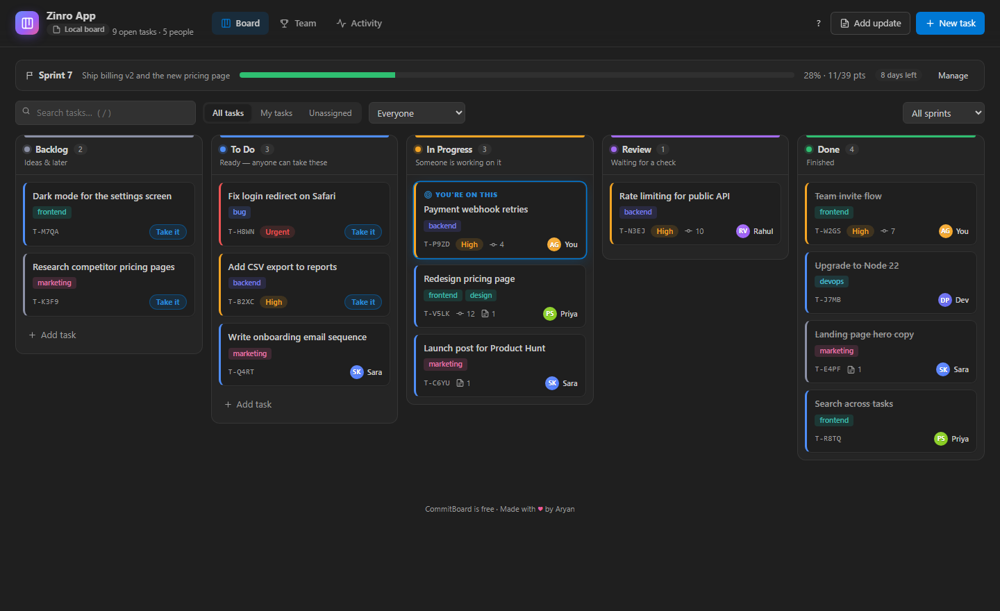
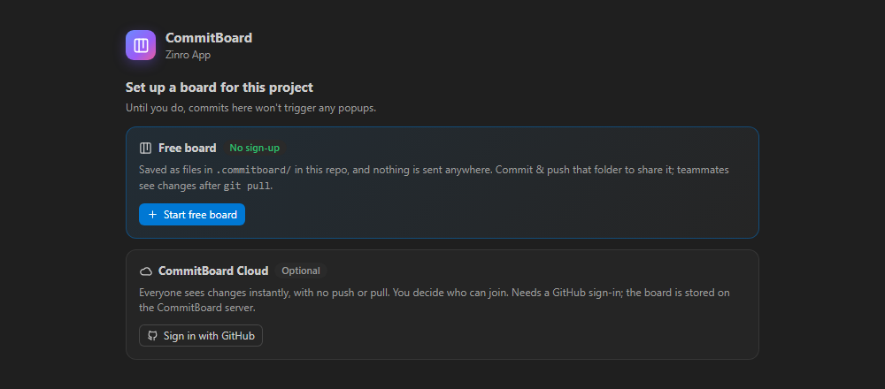
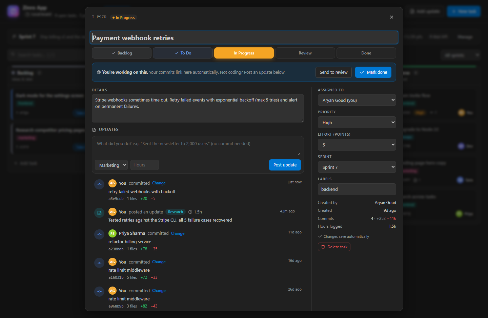
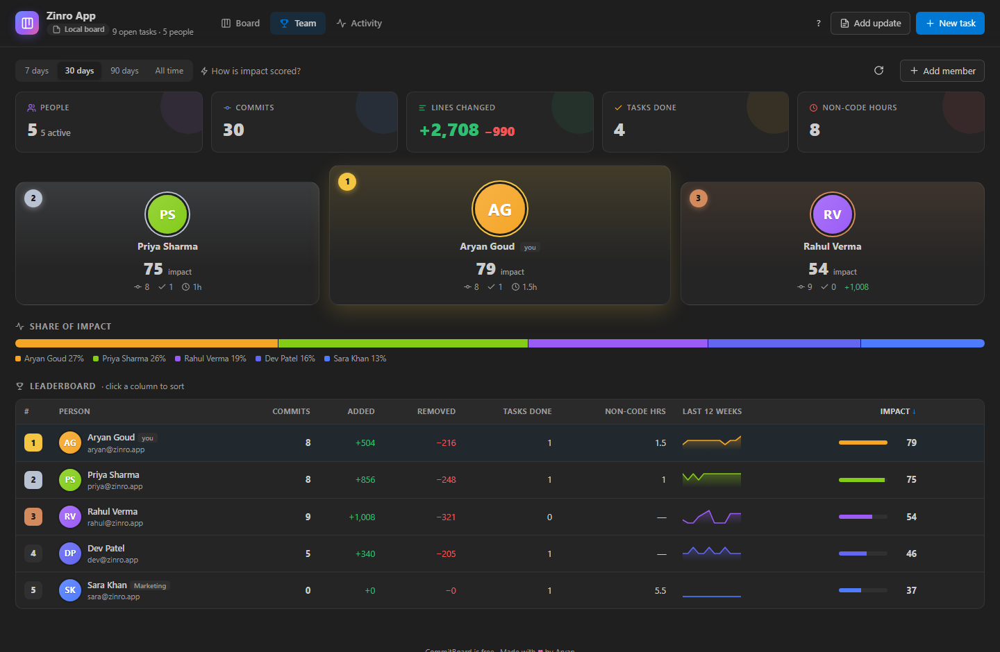
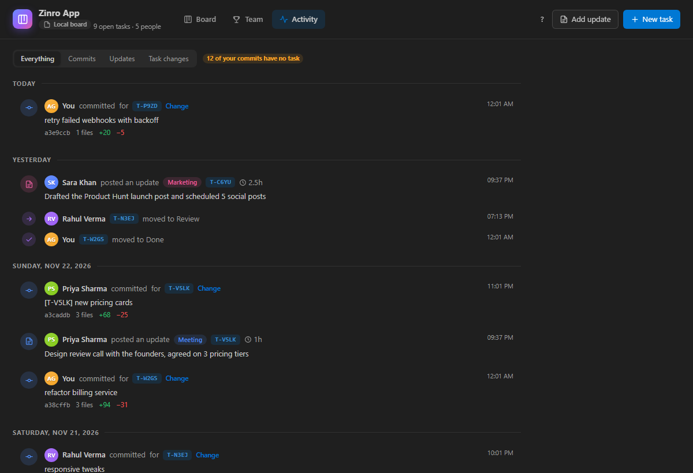
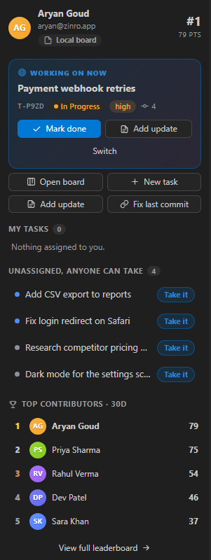
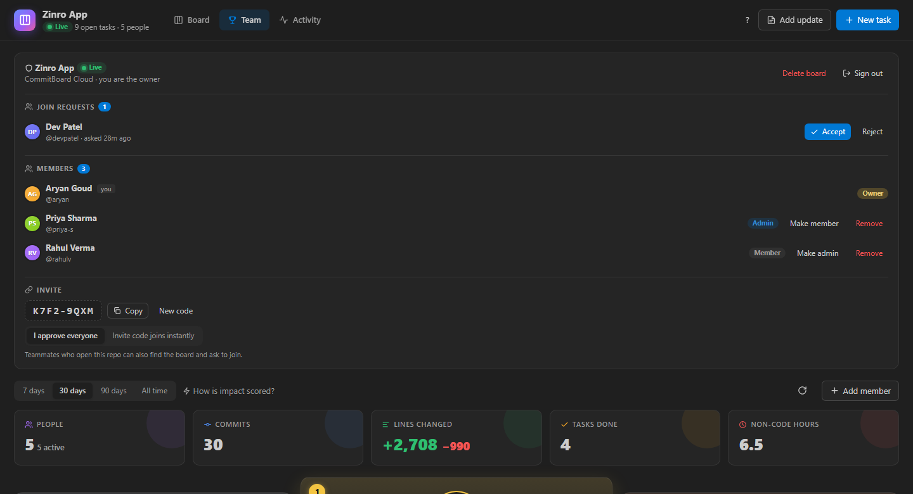

# CommitBoard

**A free Kanban and Scrum board that lives in your repo.** Plan work, pick tasks, and link every commit to the task it was for, without leaving VS Code. Marketing, design and other non-code work counts too.

No sign-up. No account. No server. The free board is stored as plain files in your repo.

## Why CommitBoard

- **Every commit gets a reason.** After you commit, CommitBoard asks *"What was this commit for?"* and links it to a task in one keystroke.
- **People choose their own work.** Unassigned tasks have a **Take it** button: the task is assigned to you, moved to In Progress, and becomes your current task.
- **Non-code work is visible.** Teammates post updates ("Sent the newsletter, 2h") on a task, with no commit needed.
- **See who shipped what.** A leaderboard combines commits, lines changed, tasks done and non-code hours.
- **It stays out of your way.** In projects without a board, CommitBoard does nothing: no popups, no tags.

## Quick start (free, about 1 minute)

1. Install **CommitBoard** and open a git repository.
2. Click the **CommitBoard** icon in the Activity Bar, then **Start free board**.
3. Create a task, click **Take it**, write some code, and commit. Pick the task in the popup.

## Using the free board with your team

The free board is saved in a `.commitboard/` folder in your repo, so it travels with your code:

1. **One person starts the board** and adds the first tasks.
2. **Commit and push the `.commitboard/` folder** like any other file.
3. **Teammates `git pull` and open the repo** with CommitBoard installed. The board appears automatically, with no setup. Each person is identified by their `git config user.name` and `user.email`.
4. **Everyone works as usual.** Taking tasks, commit links, updates and status changes are saved into `.commitboard/` and shared with each push.

Good to know:
- Merge conflicts are rare: every task is its own file, and every person writes to their own activity file.
- Changes reach teammates after push and pull. If you want instant sync, see [CommitBoard Cloud](#commitboard-cloud-optional).
- Teammates who don't write code (marketing, design) can be added under **Team -> Add member**, so they can be assigned tasks and appear on the leaderboard.

## Features

### Tasks you can open, update and finish

Click any card to open it. Change its status with one click, post an update for non-code work, and see every commit linked to it. Edits save automatically.

- Five columns: **Backlog -> To Do -> In Progress -> Review -> Done**. Drag and drop cards, or use the status bar on the task.
- Priority, effort points, labels, assignee and sprint.
- Filter by **All / My tasks / Unassigned**, by person, or by sprint. Press `n` for a new task and `/` to search.

### "What was this commit for?"

- After each commit (from the Source Control panel or the terminal), a picker opens. Press **Enter** to link it to your current task, or choose another task, create a new one, or type a short note for non-task work.
- Already wrote `[T-AB12]` in the commit message? It's linked automatically.
- After a **push**, CommitBoard offers to link any of your commits that are still unlinked.
- **Picked the wrong task?** Click **Change** on the commit, or use **Fix last commit** in the sidebar. Nothing in git needs to be reverted.
- Your current task tag is pre-filled in the commit box, and the status bar always shows what you're working on.

### Scrum sprints

Create a 1-2 week sprint with a goal. The board shows progress in points and the days left.

### Team leaderboard

- Commits, lines added and removed, tasks done, and hours of non-code work for every person.
- A top-3 podium, each person's share of the work, and a 12-week trend line.
- Filter by 7, 30 or 90 days, or all time. Click a column to sort.
- **Impact score** = commits x 3 + tasks done x 10 + story points x 5 + update hours x 4 + lines changed / 50. Lockfiles and build output are not counted.

### Activity timeline

Every commit, update and task change, grouped by day. Commits that aren't linked to a task are flagged, so they're easy to fix.

### Sidebar: your work at a glance

Your current task with **Mark done / Add update / Switch**, your tasks, unassigned tasks anyone can take, and the top contributors.

## CommitBoard Cloud (optional)

For teams that want changes to appear **instantly** for everyone, without push or pull. The free board keeps working either way.

| | Free board | CommitBoard Cloud |
|---|---|---|
| Sync | Through git (push and pull) | Instant for the whole team |
| Account | None | Sign in with GitHub (one click, built into VS Code) |
| Who can join | Anyone with access to the repo | **You approve each person**, or share an invite code |
| Where data lives | `.commitboard/` in your repo | CommitBoard server |

To use Cloud: in the CommitBoard panel choose **CommitBoard Cloud -> Sign in with GitHub -> Create team board**. Teammates who open the same repo see **Ask to join**, and you accept them under **Team -> Join requests**. You can also make people admins, remove members, or share an invite code. Already have a free board? **Team -> Move to Cloud** copies your tasks over.

Don't want Cloud at all? Turn off **CommitBoard > Cloud: Enabled** in Settings and the option disappears.

## Privacy

- **Free board:** CommitBoard never contacts any server. Your board is files in your repo, and your git history is read locally to build stats.
- **Cloud (only if you choose it):** your GitHub login, name, email and the board's content are stored on the CommitBoard server. Board owners can delete a board and all its data at any time.

## Settings

| Setting | Default | What it does |
|---|---|---|
| `commitboard.commitPrompt` | `always` | Show the "What was this commit for?" picker after your commits (`never` turns it off) |
| `commitboard.promptOnPush` | `true` | After a push, offer to link unlinked commits |
| `commitboard.autoTagCommitMessage` | `true` | Pre-fill your current task tag, e.g. `[T-AB12]`, in the commit box |
| `commitboard.maxCommits` | `5000` | How many commits of history to read for stats |
| `commitboard.excludeFromLineStats` | lockfiles, build output | Files left out of line counts |
| `commitboard.cloud.enabled` | `true` | Show the optional CommitBoard Cloud option |

## Commands

Open the Command Palette (`Ctrl+Shift+P`) and type **CommitBoard**:

- **Open Board**, **Open Contributors & Leaderboard**
- **New Task**, **Set Current Task** (or click the task in the status bar)
- **Add Update**: post non-code work
- **Link / Change Task of Last Commit**
- **Refresh**

## FAQ

**Do teammates need an account?**
No. With the free board, everyone just needs VS Code, CommitBoard and access to the repo.

**What if two people edit the board at the same time?**
Each task is a separate file and each person has their own activity file, so git merges almost always succeed automatically.

**Does it work with GitLab, Bitbucket or a self-hosted git server?**
Yes. The free board only uses git. Cloud sign-in currently uses GitHub accounts, but your repo can be hosted anywhere.

**How do I stop the commit popup?**
Set `commitboard.commitPrompt` to `never`. In projects without a board, it never appears anyway.

## About

Made by **Aryan Goud**, an indie maker. CommitBoard is free. If it helps your team, please leave a review on the Marketplace.
